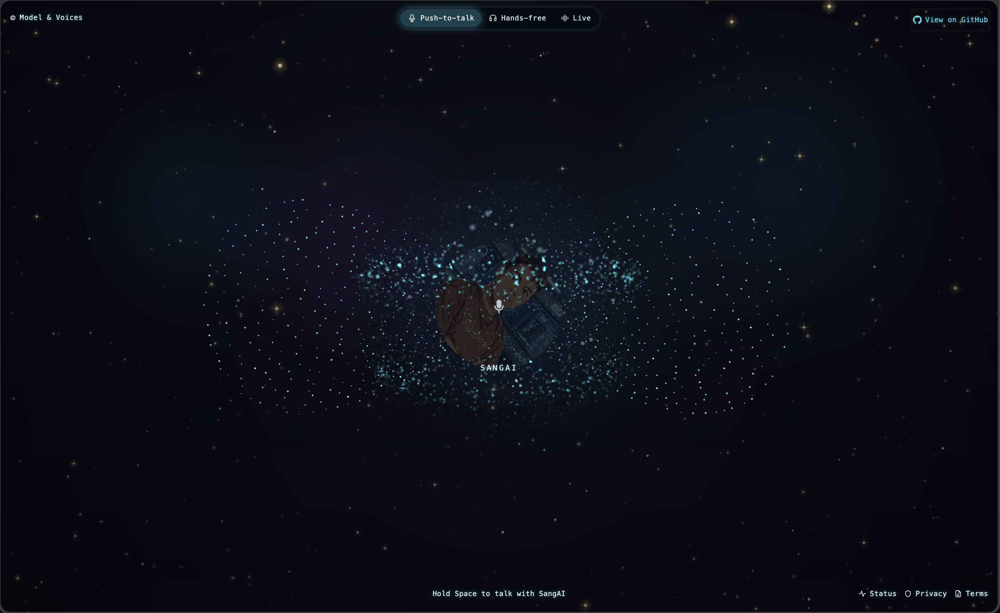

# SangAI Jarvis

SangAI Jarvis is the open-source, on-device voice and conversational assistant from SangAI. It delivers the full interactive voice interface — featuring a reactive 2D/3D orb, real-time push-to-talk speech recognition, and low-latency voice synthesis — running **100% locally in your browser**.

All neural language models run on-device via **WebGPU** ([WebLLM](https://webllm.mlc.ai/)), and all neural speech synthesis models run locally via **WebAssembly and WebGPU ONNX** (Piper, Supertonic 3, Kokoro). No cloud model APIs, external backend proxies, API keys, or server `.env` secrets are required.

## Preview

[Open the live SangAI Jarvis demo](https://www.sangai.today/).

[](https://www.sangai.today/)

---

## Quick Start

### 1. Prerequisites
- **Node.js**: v18.0.0 or later and `npm`
- **System tools**: `curl` and `sha256sum` (standard on macOS and Linux)
- **WebGPU Browser**: A modern browser with WebGPU enabled:
  - **Chrome / Chromium / Brave / Edge**: version 113+ (ensure Hardware Acceleration is enabled)
  - **Safari**: version 18+ on macOS Sequoia or iOS 18+ (with WebGPU enabled)
  - **Firefox**: version 128+ with `dom.webgpu.enabled` in `about:config`
- **Microphone**: For voice input (browsers require `http://localhost`, `http://127.0.0.1`, or HTTPS for microphone permissions)

### 2. Clone and Install

```sh
# Clone the repository
git clone https://github.com/sangaitoday/sangai-jarvis.git
cd sangai-jarvis

# Install dependencies
npm install
```

### 3. Build Runtime Assets

Build the WebLLM engine bundle, ONNX runtime bundles, and download the base voices:

```sh
npm run assets
```

> **Note:** The compiled runtime packages and model binaries under `public/webllm/` and `public/onnx/` are gitignored. Running `npm run assets` populates them locally. If you run `npm start` directly on a fresh clone, the included `prestart` hook will run this automatically if the bundles are missing.

### 4. Run the Test Suite

```sh
npm test
```

### 5. Start the Server

```sh
npm start
```

By default, the server runs on `http://127.0.0.1:8080`.

To specify a custom port or host:

```sh
PORT=9009 HOST=127.0.0.1 npm start
```

Open your browser and navigate to <http://127.0.0.1:8080>.

---

## Running with HTTPS / Mobile Devices

Microphone permissions in Web browsers require a **secure context** (`http://localhost` or HTTPS). If you want to access your Jarvis instance from your phone or across the network, expose the server over HTTPS using a lightweight tunnel such as Cloudflare Tunnel:

```sh
cloudflared tunnel --url http://127.0.0.1:8080
```

---

## Features

### 1. On-Device LLMs (`On this device`)
- **159 WebLLM model variants** across 65 model families (including Llama 3.2, Qwen 2.5, Gemma 2, Phi 3.5, Mistral, and DeepSeek).
- **Automatic hardware gating**: Evaluates your GPU vendor, memory limits, and float16 shader support to filter and rank only the models that run smoothly on your device.
- **Client-side storage**: Model weights stream directly from Hugging Face into your browser's Cache Storage on first use. You can download or delete model weights at any time from the `Models` drawer.

### 2. Local Voice Engine (`Voice`)
- **162 downloadable offline voices**:
  - **Piper**: High-speed, lightweight neural speech running via ONNX Runtime WebAssembly SIMD.
  - **Supertonic 3**: Expressive neural speech synthesis running via WebGPU.
  - **Kokoro**: High-fidelity, natural sounding neural voice synthesis.
- **Browser built-in voices**: Instant fallback to your operating system's native `speechSynthesis` voices without downloading any model files.
- **Voice management**: Filter by language and name, group by gender or provider, preview samples, and batch download or clear voice caches.

### 3. Interactive Orb & Audio Visualizer
- **Reactive 2D/3D Orb**: Renders a dynamic particle lattice and audio reactor that responds to speech and state changes (Ready, Listening, Thinking, Speaking).
- **Push-to-Talk & Hands-Free**: Hold the Spacebar or press and hold the Orb to speak. You can switch to continuous Hands-Free mode or toggle the text input field anytime.

---

## Architecture & Zero-Cloud Guarantee

- **Zero API Keys**: No accounts, credit cards, or tokens required.
- **Zero Server State**: `server.js` is a static file server with byte-range streaming (`Range: bytes`), immutable asset caching, and trailing-slash normalization. You can also host the `public/` directory on any static provider (Cloudflare Pages, Vercel, GitHub Pages, Nginx).
- **Private & Local**: Your audio and prompt text never leave your computer. Model inference executes on your local GPU via WebGPU.

---

## About SangAI

**SangAI** is an autonomous, open-source AI platform and personal agent architecture developed by **Sang** ([sang@sangai.today](mailto:sang@sangai.today)).

- **Repository**: [github.com/sangaitoday/sangai-jarvis](https://github.com/sangaitoday/sangai-jarvis)
- **Contact & Inquiries**: [sang@sangai.today](mailto:sang@sangai.today)

If you find a bug, have a feature request, or wish to contribute, please [open an issue](https://github.com/sangaitoday/sangai-jarvis/issues) on GitHub or contact Sang directly.

---

## License

This project is open-source software licensed under the **MIT License**. See the [LICENSE](LICENSE) file for details.

The speech engines and model assets have separate licenses:

- **Piper**: [Piper software license (MIT)](https://github.com/rhasspy/piper/blob/master/LICENSE.md). Individual voice files have their own model cards and terms; this project bundles [English Lessac](https://huggingface.co/diffusionstudio/piper-voices/tree/840e38a7e26d813bd6221b78cfbaefa3585b3f71/en/en_US/lessac/medium) and [Vietnamese VAI1000](https://huggingface.co/diffusionstudio/piper-voices/tree/840e38a7e26d813bd6221b78cfbaefa3585b3f71/vi/vi_VN/vais1000/medium).
- **Supertonic 3**: [sample code is MIT; model weights use OpenRAIL-M](https://huggingface.co/Supertone/supertonic-3), with the [full model license](https://huggingface.co/Supertone/supertonic-3/blob/main/LICENSE).
- **Kokoro**: the [Kokoro 82M ONNX model is Apache-2.0](https://huggingface.co/onnx-community/Kokoro-82M-v1.0-ONNX/tree/1939ad2a8e416c0acfeecc08a694d14ef25f2231).

Copyright (c) 2026 SangAI (Sang <sang@sangai.today>) and contributors.
Third-party model icon notices are documented in `public/vendor/model-icons/NOTICE.md`.
